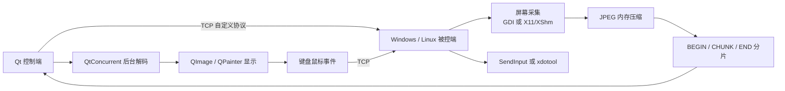

# Remote Control：Windows/Linux 跨平台远程控制实践

使用 **C++17、Qt 6、TCP、Win32/GDI 和 X11/XShm** 实现的跨平台远程控制项目。Windows 与 Linux 共用一套中文 Qt 界面和通信协议，每台设备启动一个 `remote_control` 程序后，既可以控制其他设备，也会自动运行本机被控服务。

> 项目用于学习和展示跨平台网络、桌面采集、图像传输、远程输入与 GUI 并发协作。当前没有身份认证和传输加密，请勿直接用于生产公网环境。

[项目亮点](#项目亮点) · [验证范围](#验证范围) · [协议设计](#屏幕传输协议) · [编译运行](#编译) · [秋招项目速览](docs/autumn-recruitment-showcase.md) · [修改日志](CHANGELOG.md)

## 项目亮点

- **跨平台双端能力**：Windows/Linux 均可作为控制端和被控端，四种组合共用协议与 Qt 控制界面。
- **统一中文 Qt 应用**：一个程序包含“控制其他设备”和“允许远程控制”两个页面，并通过 `QProcess` 自动管理原生服务端。
- **完整屏幕链路**：GDI 或 X11/XShm 截屏，经 JPEG 内存压缩、分片传输、完整性校验、后台解码后使用 `QImage/QPainter` 显示。
- **远程键鼠控制**：支持移动、按下、抬起、双击、滚轮和常用键盘按键，按实际画面区域完成黑边坐标映射。
- **连接可靠性**：支持双向心跳、10 秒失活检测、指数退避重连、服务端重复接入和会话资源清理。
- **实时性处理**：使用单槽位最新帧覆盖，避免已经接收完成但尚未解码的历史画面持续堆积。
- **工程化交付**：提供 Windows x64 便携包和 Ubuntu 22.04 amd64 安装包构建流程，并保留分阶段测试记录。

## 验证范围

| 控制端 | 被控端 | 已验证内容 |
| --- | --- | --- |
| Windows Qt | Windows server | 公网双机连接、心跳、远程画面与键鼠控制 |
| Windows Qt | Linux server | TCP 协议握手与心跳，往返约 1 ms |
| Linux Qt | Windows server | TCP 会话建立 |
| Linux Qt | Linux server | TCP 会话建立 |

- Windows 统一应用已验证自动启动 `win_server.exe` 并监听 `0.0.0.0:9999`。
- Ubuntu 安装包已验证自动启动 `/opt/remote-control/linux_server` 并监听 `0.0.0.0:9999`。
- Linux 实体机上的 X11 画面、键鼠控制和不同桌面环境兼容性仍需继续验收。
- 原生 Wayland 输入注入不在当前支持范围内。

## 技术架构



```text
remote_control
├── 控制其他设备：QTcpSocket + 画面重组 + 后台解码 + 键鼠采集
└── 允许远程控制：QProcess 自动管理平台原生服务端
    ├── Windows：win_server.exe
    └── Linux：linux_server
```

## 项目结构

```text
remote_control/
├── common/
│   ├── packet.h              # 协议、命令和固定宽度结构
│   ├── heartbeat.h           # 心跳负载与超时参数
│   └── reconnect.h           # 指数退避计算
├── third_party/
│   ├── stb_image.h           # JPEG 内存解码
│   ├── stb_image_write.h     # JPEG 内存编码
│   └── README.md
├── windows/
│   ├── CMakeLists.txt
│   ├── server.cpp            # Windows 被控端
│   ├── client.cpp            # 原生 Win32 控制端
│   └── qt_client/            # Qt 连接、画面与键鼠控制
├── linux/
│   ├── CMakeLists.txt
│   ├── server.cpp            # Linux 被控端
│   └── client.cpp            # 原生 X11 控制端
├── qt_app/                    # Windows/Linux 共用中文主界面
├── qt_server/                 # 自动服务管理与日志界面
├── packaging/                 # Ubuntu/Debian 安装包配置
├── docs/                      # 分阶段设计与验证记录
├── CHANGELOG.md
├── LICENSE
└── README.md
```

## 核心功能

**网络与协议**

- WinSock/POSIX Socket TCP 通信，支持 IPv4、域名和自定义端口。
- 固定包头与增量缓冲区处理粘包、半包和连续多包。
- 约 64 KB 屏幕分片，支持 JPEG 与旧 BGRA32 格式。
- Qt 原始 TCP 连接强制直连，不受系统 HTTP 代理影响。

**画面与输入**

- Windows GDI、Linux X11/XShm 原始桌面分辨率截屏。
- quality 75 JPEG 内存编解码，不产生临时图片文件。
- 居中等比例缩放、黑色留边和实际画面区域坐标映射。
- 鼠标移动、按下、抬起、双击、滚轮及键盘按下/抬起。

**Qt 与连接管理**

- Windows/Linux 共用中文 Qt 界面，单程序同时提供控制端与被控端入口。
- 启动界面时自动运行平台服务，无需用户手动启动 server。
- 双向心跳、超时断开、指数退避重连与服务端重复接入。
- 后台 JPEG 解码和单槽位最新帧更新，保持 GUI 响应。

服务端始终捕获并发送远程桌面的原始宽高。窗口缩放只发生在客户端显示阶段，不会要求服务端降低分辨率。

## 屏幕传输协议

四端共享 [common/packet.h](common/packet.h)，基础 Packet 格式保持为：

```text
magic | cmd | body_len | data
```

协议整数使用 `int32_t`，并通过 `static_assert` 检查关键结构的线宽大小：

```text
Packet header       12 bytes
MouseEvent          16 bytes
KeyEvent            36 bytes
ScreenFrameInfo     20 bytes
ScreenChunkHeader   12 bytes
HeartbeatPayload    16 bytes
```

屏幕传输仍使用原有三阶段流程：

```text
CMD_SCREEN_BEGIN
CMD_SCREEN_CHUNK × N
CMD_SCREEN_END
```

`SCREEN_BEGIN` 中的屏幕信息为：

```cpp
struct ScreenFrameInfo {
    int32_t frame_id;
    int32_t width;
    int32_t height;
    int32_t total_size;
    int32_t format;
};
```

- `width`、`height`：远程桌面原始分辨率
- `total_size`：当前格式实际发送的字节数；JPEG 模式下为压缩后的大小
- `format`：`SCREEN_FORMAT_BGRA32` 或 `SCREEN_FORMAT_JPEG`

默认发送格式为 JPEG：

```cpp
SCREEN_FORMAT_BGRA32 = 0
SCREEN_FORMAT_JPEG = 1
```

客户端只有在收到匹配的 `SCREEN_BEGIN`、连续完整的所有分片和对应 `SCREEN_END`，且累计字节数严格等于 `total_size` 后才会解码。新帧开始时会清理未完成旧帧。

协议编码缓冲区使用 `std::vector<char>` 管理。编码函数返回拥有内存所有权的对象，发包完成或函数提前返回时都会自动释放，不再要求四个端点手动配对 `malloc/free`。`vector` 同时保存连续地址和实际长度，适合直接传给同步 `send` 循环。

## 连接心跳

Windows/Linux 的 server 和 client 使用同一套双向心跳：

```text
CMD_HEARTBEAT_PING(sequence, sent_at_ms)
CMD_HEARTBEAT_PONG(sequence, sent_at_ms)
```

- 连续 3 秒没有收到完整有效包时发送 `PING`。
- 收到 `PING` 后原样回传负载，并将命令改为 `PONG`。
- 收到任意完整有效包都会刷新最近活动时间。
- 连续 10 秒没有收到完整有效包时主动关闭连接。
- 画面线程、输入线程和心跳处理共用发包互斥锁，防止两个 TCP 消息的字节交叉写入。

心跳只负责发现失效连接并结束当前会话，不会自动重新连接。

## 自动重连

客户端在已经成功建立会话后发生断线，会使用递增等待时间自动重连：

```text
1s -> 2s -> 4s -> 8s -> 8s ...
```

- 每次连接失败后增加等待时间，最长为 8 秒。
- 连接成功后清零重试次数。
- 等待期间可以点击连接按钮，取消倒计时并按当前输入立即连接。
- 首次手动连接失败不会无限重试，方便用户修改错误的地址或端口。
- Windows 和 Linux 服务端都会在当前客户端断开后返回 `accept`，等待下一次连接。
- 每个新会话都会强制发送第一帧，即使远程桌面内容没有变化。

服务端监听套接字和当前会话套接字使用不可复制、可移动的 `SocketHandle` 管理。会话结束时先调用 `shutdown` 唤醒可能阻塞的画面线程，等待线程退出后再由析构函数执行 `close`/`closesocket`。Windows 的 `WSAStartup/WSACleanup` 也由独立运行时对象成对管理。

## JPEG 编码

### Windows server

1. 使用 `GetDC`、`CreateDIBSection` 和 `BitBlt` 捕获原始桌面。
2. 截屏结果为 BGRA32。
3. 显式执行 BGRA → RGB，避免红蓝通道颠倒。
4. 使用 `stbi_write_jpg_to_func` 在内存中编码 quality 75 JPEG。
5. 将 JPEG 字节通过 begin/chunk/end 流程发送。

### Linux server

1. 使用 X11/XShm 捕获原始桌面。
2. 根据 `XImage` 的 `bits_per_pixel` 和 `byte_order` 读取像素。
3. 根据 `red_mask`、`green_mask` 和 `blue_mask` 提取 RGB，不假定固定 BGRX 排列。
4. 生成连续 RGB 缓冲区。
5. 使用 `stbi_write_jpg_to_func` 在内存中编码 quality 75 JPEG。
6. 将 JPEG 字节通过同一套屏幕协议发送。

两个服务端都不会写临时图片文件，也不会缩放或裁剪远程桌面。

每发送 10 个变化帧会输出一次编码统计：

```text
frame_id
capture_ms
color_convert_ms
jpeg_encode_ms
send_ms
raw_size
jpeg_size
compression_ratio
chunk_count
```

## 客户端解码与实时性

两个客户端都支持：

- `SCREEN_FORMAT_JPEG`：使用 `stbi_load_from_memory` 强制解码为 RGBA，再转换为显示需要的格式
- `SCREEN_FORMAT_BGRA32`：保留原始 BGRA32 兼容路径
- 严格检查 `frame_id`、分片 offset、累计大小和 `SCREEN_END`
- 不解码残缺 JPEG
- 新完整帧覆盖尚未处理的旧完整帧
- 屏幕处理队列不影响鼠标、键盘和连接命令
- 断线时停止图像处理线程并清理缓存

### Windows client

- 网络线程只负责收包和完整帧重组。
- 后台线程执行 JPEG 解码和 RGBA → BGRA 转换。
- 解码完成后通过窗口消息通知 GUI。
- 所有正式绘制都由 `WM_PAINT` 完成。
- 显示帧使用互斥锁和只读共享缓冲区保护。

### Linux client

- 网络循环负责完整帧重组。
- 解码线程负责 JPEG → RGBA → BGRA。
- 独立缩放线程生成当前窗口尺寸对应的双线性缩放缓冲区。
- 缩放结果根据当前 X11 Visual 的位深、字节序和 RGB masks 转为 XImage 原生像素。
- X11 线程只处理事件、黑色清屏和最终 `XPutImage`。
- 新帧或新窗口尺寸会覆盖过期缩放请求。

## 客户端缩放和重绘

两个客户端都根据远程宽高比和窗口客户区计算最大的等比例显示区域：

```text
remote_width / remote_height
window_width / window_height
display_x / display_y
display_width / display_height
```

远程画面在窗口中居中，未占用区域填充为黑色。

### Windows

- `WM_SIZE` 更新客户区尺寸并触发重绘。
- `WM_PAINT` 使用 `GetClientRect` 获取实时客户区。
- 先填充黑色背景。
- 使用 `SetStretchBltMode(hdc, HALFTONE)` 和 `StretchDIBits` 等比例绘制。
- 窗口被遮挡、最小化后恢复或改变大小时，使用最近一帧重绘。
- 没有有效帧时只显示黑色背景。

### Linux

- 监听 `ConfigureNotify` 和 `Expose`。
- 远程窗口可以自由放大和缩小。
- 初始窗口按远程宽高比适配到当前显示器约 80%，较小画面不主动放大。
- `ConfigureNotify` 产生新的单槽位缩放请求。
- `Expose` 使用最近准备好的显示缓冲区重绘。
- 新尺寸缓冲区尚未完成时显示黑色背景，不拉伸尺寸不匹配的旧缓冲。

## 鼠标坐标映射

鼠标坐标不再直接按照整个窗口映射，而是按照实际画面显示区域转换：

```text
remote_x = (mouse_x - display_x) * remote_width / display_width
remote_y = (mouse_y - display_y) * remote_height / display_height
```

- 位于上下或左右黑边时不发送远程鼠标事件。
- 映射结果限制在远程桌面有效范围。
- 鼠标移动、按键、点击、双击和滚轮共用同一个转换函数。
- 键盘协议不受显示缩放影响。

## 编译

项目使用 C++17。`stb_image` 和 `stb_image_write` 已包含在 `third_party`，不需要单独安装 JPEG 库。

### Windows

需要 CMake 和支持 C++17 的编译器。使用 MinGW：

```powershell
cmake -S windows -B windows/build -G "MinGW Makefiles"
cmake --build windows/build --target win_server win_client -j 4
```

如果构建目录已经由 Ninja 或 Visual Studio 配置，继续使用同一生成器：

```powershell
cmake --build windows/build --target win_server win_client -j 4
```

生成：

```text
windows/build/win_server.exe
windows/build/win_client.exe
```

统一 Qt 程序使用 Qt 6 的 Widgets、Network 和 Concurrent 模块：

```powershell
D:\Qt\Tools\CMake_64\bin\cmake.exe `
    -S windows -B build/qt-windows -G Ninja `
    -DCMAKE_PREFIX_PATH=D:\Qt\6.11.2\mingw_64 `
    -DCMAKE_C_COMPILER=D:\Qt\Tools\mingw1310_64\bin\gcc.exe `
    -DCMAKE_CXX_COMPILER=D:\Qt\Tools\mingw1310_64\bin\g++.exe `
    -DBUILD_QT_APP=ON

D:\Qt\Tools\CMake_64\bin\cmake.exe `
    --build build/qt-windows --target remote_control win_server
```

生成的 `remote_control.exe` 是用户唯一需要启动的程序。`win_server.exe` 与它放在同一目录，由 Qt 界面自动在后台启动。

也可以从命令行预填地址并立即连接，便于本机联调：

```powershell
$env:Path = "D:\Qt\6.11.2\mingw_64\bin;D:\Qt\Tools\mingw1310_64\bin;$env:Path"
.\build\qt-windows\remote_control.exe --host 127.0.0.1 --port 9999 --connect
```

### Linux

安装依赖：

```bash
sudo apt update
sudo apt install build-essential cmake ninja-build pkg-config \
    qt6-base-dev libgl1-mesa-dev libx11-dev libxext-dev xdotool
```

编译：

```bash
cmake -S linux -B build/qt-linux -G Ninja \
    -DCMAKE_BUILD_TYPE=Release \
    -DBUILD_QT_APP=ON

cmake --build build/qt-linux --target remote_control linux_server
```

## 运行

Windows 和 Linux 的 Qt 程序启动后会自动在后台监听：

```text
0.0.0.0:9999
```

### Windows

Windows：

```powershell
.\build\qt-windows\remote_control.exe
```

### Linux

```bash
./build/qt-linux/remote_control
```

程序包含两个中文页签：

- `控制其他设备`：输入对方地址和端口，查看画面并发送键鼠操作。
- `允许远程控制`：查看本机服务状态、服务程序路径和实时日志，也可以停止或重新启动服务。

Linux client 也可以用命令行参数预填连接信息：

```bash
./build/qt-linux/remote_control --host 192.168.1.10 --port 9999
./build/qt-linux/remote_control --host example.tcp.cpolar.cn --port 12345 --connect
```

Linux 项目当前依赖 X11/XShm 和 xdotool，因此 Qt 程序默认使用 xcb/X11 后端。原生 Wayland 输入注入不在当前支持范围内。

## 连接配置

Qt 控制端使用 `QSettings` 保存最近一次服务地址和端口，重新启动应用后自动恢复。

原生客户端继续从可执行文件所在目录读取 `server.conf`。

Windows 原生 client 使用两行格式：

```text
192.168.1.10
9999
```

Linux 原生 client 使用键值格式：

```text
ip=192.168.1.10
port=9999
```

`server.conf` 已被 `.gitignore` 忽略，不应提交。

## cpolar

cpolar 仍使用普通 TCP 隧道，不需要修改应用协议。例如将被控端本地 `9999` 暴露到公网：

```bash
cpolar tcp 9999
```

将 cpolar 返回的域名和端口输入客户端连接界面即可。使用公网隧道前请注意：当前项目没有身份认证和加密，暴露端口存在安全风险。

## 当前限制

- 没有身份认证、授权、加密或完整的公网安全机制。
- 自定义结构采用固定 32 位字段并保持现有直接序列化方式，没有增加网络字节序转换或协议版本协商。
- 屏幕采用完整 JPEG 帧传输，没有差分编码、码率控制或视频编码。
- JPEG 编解码和双线性缩放会消耗 CPU，实际帧率和延迟需要在目标机器上测量。
- Linux 输入模拟依赖 `xdotool`，主要面向 X11；不支持原生 Wayland 输入控制。
- Windows server 当前使用主桌面 GDI 捕获逻辑，不包含专门的多显示器布局管理。
- 项目按单客户端连接流程设计。
- 四种 Qt/TCP 组合已经完成构建与握手验证；Linux 实体机画面和键鼠仍需继续回归。

## 说明

本项目主要用于学习和展示以下内容：

- C++ 跨平台网络编程
- TCP 应用层消息边界处理
- Win32/GDI 与 X11/XShm 桌面捕获
- 内存 JPEG 编解码
- GUI 重绘、等比例缩放和输入坐标映射
- 多线程图像流水线与最新帧策略

请在受控网络和测试环境中使用。
